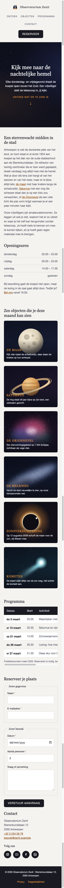
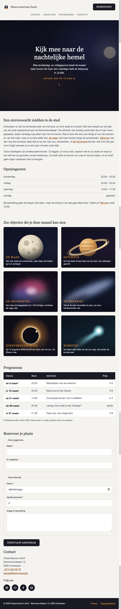
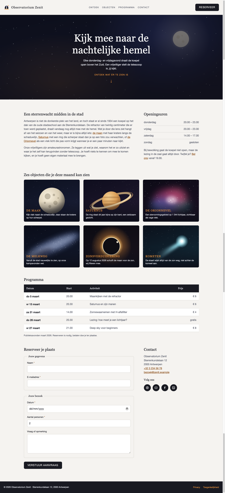
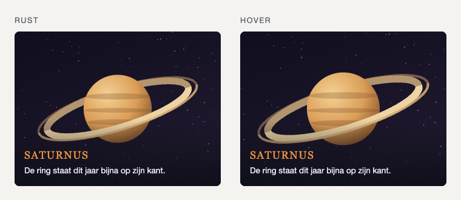

# Observatorium Zenit

Je bouwt een responsive _one-pager_ voor een publieke sterrenwacht in Antwerpen. Bijna alle onderwerpen die je tot nu toe gezien hebt komen hier samen: de pagina gebruikt **CSS Grid** voor het kaartenraster, bevat een **tabel** en een **formulier**, en is strikt **mobile first** opgebouwd.

## Extra: samenwerken

Maak deze oefening per twee. Spreek onderling af wie aan welke sectie begint,
zodat jullie niet tegelijk dezelfde code aanpassen.

Maak regelmatig kleine, duidelijke commits. Push en pull vaak, zodat jullie
wijzigingen gesynchroniseerd blijven en merge conflicts tot een minimum
beperkt blijven.

Jullie kiezen zelf hoe jullie samenwerken: met pull requests of door
rechtstreeks naar `main` te pushen. Spreek vooraf af welke werkwijze jullie
gebruiken.

## Wat krijg je

In de map `startbestanden/` vind je:

| Bestand | Waarvoor |
|---|---|
| `css/normalize.css` | [modern-normalize](https://github.com/sindresorhus/modern-normalize), link je als eerste stylesheet |
| `assets/hero-night-sky.svg` | achtergrond van de hero (1600 &times; 900) |
| `assets/object-*.svg` | zes afbeeldingen voor het kaartenraster (telkens 800 &times; 600, dus allemaal dezelfde verhouding) |
| `assets/icon-*.svg` | vier witte social media-iconen (48 &times; 48, transparante achtergrond) |
| `assets/logo.svg` | het logo-icoontje (48 &times; 48) |

De afbeeldingen zijn SVG. Die blijven scherp op elk scherm, maar je gebruikt ze verder precies zoals een JPG of WEBP: met een ``-element of als `background-image`.

## Bestandenstructuur

Kopieer de inhoud van `startbestanden/` naar je eigen oefeningenmap, zodat je dit krijgt:

```text
webtechnologie/
└─ labo-11/
   └─ observatory/
      ├─ index.html
      ├─ css/
      │  ├─ normalize.css
      │  └─ style.css
      └─ assets/
         ├─ hero-night-sky.svg
         ├─ icon-facebook.svg
         ├─ icon-instagram.svg
         ├─ icon-linkedin.svg
         ├─ icon-youtube.svg
         ├─ logo.svg
         ├─ object-comet.svg
         ├─ object-eclipse.svg
         ├─ object-milky-way.svg
         ├─ object-moon.svg
         ├─ object-orion.svg
         └─ object-saturn.svg
```

## Verwacht resultaat

**Mobiel (tot 639px)**



**Tablet (640px tot 1023px)**



**Desktop (vanaf 1024px)**



## Designspecificatie

Neem deze waarden letterlijk over. Zet alle kleuren en de twee lettertypes als variabelen in `:root`, bovenaan je stylesheet.

### Kleuren

| Variabele | Waarde | Gebruik |
|---|---|---|
| `--color-surface` | `rgb(246, 245, 242)` | achtergrond van de pagina |
| `--color-card` | `rgb(255, 255, 255)` | invoervelden en de oneven tabelrijen |
| `--color-ink` | `rgb(26, 28, 38)` | titels, footer, tabelhoofding, knop |
| `--color-muted` | `rgb(96, 100, 115)` | lopende tekst |
| `--color-line` | `rgb(214, 212, 205)` | randen en scheidingslijnen |
| `--color-on-dark` | `rgb(236, 238, 246)` | tekst op een donkere achtergrond |
| `--color-accent` | `rgb(242, 160, 58)` | accent **op donkere achtergrond** |
| `--color-accent-dark` | `rgb(150, 88, 10)` | accent **op lichte achtergrond**, zoals links |
| `--color-valid` | `rgb(42, 132, 72)` | rand van een correct ingevuld veld |
| `--color-invalid` | `rgb(178, 48, 48)` | rand van een foutief ingevuld veld |

> Waarom twee accentkleuren? Het heldere amber heeft te weinig contrast met een lichte achtergrond om leesbaar te zijn. Op donker werkt het wel. Gebruik dus altijd de variant die bij de achtergrond past.

### Lettertypes

| Variabele | Waarde | Gebruik |
|---|---|---|
| `--font-heading` | `Georgia, "Times New Roman", serif` | `h1`, `h2`, `h3`, `legend`, tabelhoofding |
| `--font-body` | `"Helvetica Neue", Arial, sans-serif` | al de rest |

### Breakpoints

Je werkt **mobile first**: de regels die je buiten een media-query schrijft gelden voor de smalste schermen, en je bouwt daarop verder met `min-width`.

| Breakpoint | Media-query |
|---|---|
| tablet | `@media (min-width: 640px)` |
| desktop | `@media (min-width: 1024px)` |

Meer dan deze twee heb je niet nodig.

## Opbouw van de pagina

### Algemene lay-out

De `body` is een **grid** met vier rijen boven elkaar en `grid-template-areas`:

```text
"header"
"hero"
"main"
"footer"
```

- Geef de `body` `min-height: 100vh` en rijen `auto auto 1fr auto`, zodat de footer altijd onderaan het venster staat, ook als de pagina kort is.
- Geef het grid één kolom met `grid-template-columns: 1fr`.
- Zet `min-width: 0` op `main`. Een grid-item heeft standaard `min-width: auto` en probeert daardoor minstens even breed te blijven als zijn breedste inhoud. De tabel heeft verderop bewust een minimumbreedte. Zonder `min-width: 0` kan die tabel `main` en daarmee de volledige pagina breder maken dan het scherm. Met deze regel mag `main` binnen de gridkolom krimpen en blijft alleen het tabelblok horizontaal scrollbaar.
- `main` is zelf een flex-container in kolomrichting die zijn secties **horizontaal centreert**. De secties zijn `width: 100%` met een `max-width` van `70rem`.

### 1. Header

**Inhoud**

- Het logo: een link naar `index.html` met daarin het logo-icoontje en de tekst "Observatorium Zenit".
- Een `nav` met een lijst van vier links: Ontdek (`#discover`), Objecten (`#objects`), Programma (`#programme`) en Contact (`#contact`).
- Een knop "Reserveer" die naar `#contact` springt.

**Techniek**

- De vier navigatielinks staan in een `ul`. Haal de bolletjes en de onderlijning weg.
- Het logo-icoontje is **decoratief**: de tekst ernaast zegt al wat het is. Geef het dus een lege `alt=""`, zodat een schermlezer het overslaat.
- Omdat er twee `nav`-elementen op de pagina staan (header en footer), geef je ze elk een `aria-label` zodat een schermlezer ze uit elkaar houdt.
- De header is een flex-container:
  - **mobiel**: kolomrichting, alles gecentreerd;
  - **tablet**: logo links, knop rechts, en de navigatie op een eigen regel eronder. Dat krijg je met `flex-wrap: wrap` op de header plus `flex-basis: 100%` en `order: 1` op de `nav`;
  - **desktop**: alles op een enkele regel, dus `flex-wrap: nowrap` en de `order` terug op `0`.
- Bij hover of focus van een navigatielink groeit er een lijntje van links naar rechts onder de link. Maak dat met een `::after` pseudo-element. Geef het `display: block`, een hoogte van `2px` en een kleine `margin-top`, zodat het gewoon onder de linktekst staat. Laat het met een `transition` van `transform: scaleX(0)` naar `scaleX(1)` gaan en zet `transform-origin: left`.

### 2. Hero (`<section id="hero">`)

**Inhoud**

- Een `h1`: "Kijk mee naar de nachtelijke hemel".
- Een korte paragraaf eronder.
- Een link "Ontdek wat er te zien is" die naar `#discover` springt, met een pijltje eronder dat zachtjes op en neer beweegt.

**Techniek**

- De hero staat **buiten** `main` want het is geen inhoud maar de kop van de pagina, en hij krijgt het grid-gebied `hero`.
- Achtergrond: `hero-night-sky.svg`, met daarbovenop een donkere `linear-gradient` zodat de tekst leesbaar blijft. Je kan twee achtergronden in een enkele `background-image` stapelen, gescheiden door een komma. De bovenste in de lijst ligt vooraan.
- Gebruik `background-size: cover`, `background-position: center` en `background-repeat: no-repeat`. Zet ook een `background-color` in de kleur `--color-ink` als vangnet, voor het geval de afbeelding niet laadt.
- Minimumhoogte `60vh`, inhoud verticaal en horizontaal gecentreerd met flexbox.
- De `h1` is **niet** even groot op elk scherm: `2rem` op mobiel, `2.75rem` op tablet en `4rem` op desktop.
- Het pijltje maak je met een `::after` op de link, met `content: "↓"` en een `@keyframes`-animatie die het 1,8 seconden lang heen en weer schuift en zich eindeloos herhaalt.

### 3. Ontdek (`<section id="discover">`)

**Inhoud**

- Links een `article` met een `h2`, twee paragrafen, en in de eerste paragraaf drie links naar `#objects`.
- Rechts een `aside` met een `h2` "Openingsuren", een lijst met vier dagen en hun uren, en een korte paragraaf met een link naar `#contact`.

**Techniek**

- Flex-container: **kolom** op mobiel en tablet, **rij** op desktop. Op desktop is het artikel twee keer zo breed als de aside (`flex: 2` tegenover `flex: 1`).
- De openingsuren staan in een `ul` zonder bolletjes. Elk `li` is zelf een kleine flexbox met `justify-content: space-between`, zodat de dag links staat en het uur rechts.
- Elk `li` krijgt een onderrand, behalve het laatste. Gebruik `:last-child`.
- Schrijf het liggend streepje tussen de uren als HTML-entiteit (`&ndash;`).
- Geef de `aside` via `aria-labelledby` de tekst van de titel als toegankelijke naam. Er staat verderop nog een tweede `aside` op de pagina, dus zo kunnen schermlezers beide landmarks uit elkaar houden.

### 4. Objecten (`<section id="objects">`)

**Inhoud**

Een `h2` en daaronder zes kaarten. Elke kaart toont een afbeelding met daarover, onderaan, een titel en een regel uitleg. De hele kaart is een link.

| Afbeelding | Titel | Regel eronder |
|---|---|---|
| `object-moon.svg` | De Maan | Kijk vlak naast de schaduwlijn, daar staan de kraters op hun scherpst. |
| `object-saturn.svg` | Saturnus | De ring staat dit jaar bijna op zijn kant, een zeldzaam gezicht. |
| `object-orion.svg` | De Orionnevel | Een stervormingsgebied op 1 344 lichtjaar, zichtbaar als vage vlek. |
| `object-milky-way.svg` | De Melkweg | Vanuit de stad nauwelijks te zien, op onze kampavonden wel. |
| `object-eclipse.svg` | Zonsverduistering | Op 12 augustus 2026 schuift de maan voor de zon, wij filteren mee. |
| `object-comet.svg` | Kometen | De staart wijst altijd van de zon weg, niet achter de komeet aan. |

**Techniek**

- De zes kaarten vormen een **lijst**: een `ul` met zes `li`. Haal de bolletjes weg.
- Binnen elk `li` staat een `a` met daarin een `figure`, met daarin de `img` en een `figcaption`. De titel (`h3`) en de regel uitleg staan **in** de `figcaption`, want ze horen bij de afbeelding. Bouw alle zes de kaarten op precies dezelfde manier.
- Het raster is een **grid**:

  ```css
  grid-template-columns: repeat(auto-fit, minmax(18rem, 1fr));
  ```

  Daardoor kiest de browser zelf het aantal kolommen: 1 op mobiel, 2 op tablet en 3 op desktop. **Je hebt hier dus geen media-query voor nodig.**
- Het bijschrift ligt **over** de afbeelding. Maak van de `figure` een grid, zet `img` en `figcaption` allebei in `grid-area: 1 / 1`, en lijn het bijschrift onderaan uit met `align-self: end`. Zo overlappen ze elkaar zonder dat je met negatieve marges moet werken.
- Geef de `figcaption` een `linear-gradient` van volledig doorzichtig naar bijna zwart, zodat de tekst leesbaar blijft op elke afbeelding.
- De afbeeldingen hebben allemaal dezelfde verhouding (4:3), dus `width: 100%` en `height: auto` volstaat om alle kaarten even hoog te krijgen.
- Vermeld `width` en `height` als attribuut op elke `img` (`width="800" height="600"`, dus **zonder** eenheid). De browser houdt dan al plaats vrij voor de afbeelding voor ze geladen is.
- Elke afbeelding krijgt een `alt` die beschrijft wat erop staat.

### 5. Programma (`<section id="programme">`)

**Inhoud**

Een `h2` en een tabel met vijf avonden.

| Datum | Start | Activiteit | Prijs |
|---|---|---|---|
| do 5 maart | 20.00 | Maankijken met de refractor | &euro; 6 |
| vr 13 maart | 20.30 | Saturnus en zijn manen | &euro; 6 |
| za 21 maart | 14.00 | Zonnewaarnemen met H-alfafilter | &euro; 4 |
| do 26 maart | 20.30 | Lezing: hoe meet je een lichtjaar? | gratis |
| vr 27 maart | 21.00 | Deep sky voor beginners | &euro; 8 |

**Techniek**

- Gebruik `thead` en `tbody`.
- De vier kolomtitels zijn `th` met `scope="col"`. De eerste cel van elke rij in `tbody` is **ook** een `th`, met `scope="row"`, want de datum benoemt die rij.
- Voeg een `caption` toe met de tekst "Publieksavonden maart 2026. Reserveren is nodig, betalen doe je ter plaatse." en zet die met `caption-side: bottom` onder de tabel.
- `border-collapse: collapse`, en een onderrand onder elke cel.
- Zebrastrepen: geef de oneven rijen van `tbody` een witte achtergrond met `:nth-child(odd)`.
- De prijskolom staat rechts uitgelijnd. Gebruik `:last-child`.
- Het euroteken schrijf je als HTML-entiteit (`&euro;`), met een vaste spatie (`&nbsp;`) tussen het teken en het bedrag zodat ze nooit op twee regels belanden.
- **Op mobiel mag de tabel niet samengeknepen worden.** Zet de tabel in een extra `div` met `overflow-x: auto` en geef de tabel zelf een `min-width` van `34rem`. Alleen dat blokje scrollt dan horizontaal, de rest van de pagina niet.

### 6. Contact (`<section id="contact">`)

**Inhoud**

- Links een `article` met een `h2` "Reserveer je plaats" en een formulier.
- Rechts een `aside` met een `h2` "Contact", de contactgegevens en vier social media-links.

Het formulier bevat twee groepen:

| Groep | Velden |
|---|---|
| Jouw gegevens | Naam (`text`, verplicht), E-mailadres (`email`, verplicht) |
| Jouw bezoek | Datum (`date`, verplicht), Aantal personen (`number`, minimum 1, maximum 8, standaard 2, verplicht), Vraag of opmerking (`textarea`, niet verplicht) |

Onderaan staat een `button` van het type `submit` met de tekst "Verstuur aanvraag".

**Techniek**

- Dezelfde flex-opbouw als bij Ontdek: kolom op mobiel en tablet, rij op desktop, met `flex: 2` tegenover `flex: 1`.
- Geef ook deze `aside` via `aria-labelledby` de tekst van de titel als toegankelijke naam.
- Gebruik `fieldset` en `legend` voor de twee groepen.
- **Elk** veld heeft een eigen `label` dat via `for` en `id` aan het invoerveld hangt. Elk veld krijgt ook een `name`.
- Zet achter het label van elk verplicht veld automatisch een sterretje, zonder dat je dat vier keer typt. Wikkel elk label en veld samen in een element met de klasse `field` en gebruik dan:

  ```css
  .field:has(:required) label::after {
    content: " *";
  }
  ```

- Een veld in focus krijgt een duidelijke `outline` in de accentkleur. Verwijder nooit de standaard-outline zonder er zelf een in de plaats te zetten: toetsenbordgebruikers zien anders niet meer waar ze zijn.
- Geef de velden een groene of rode rand met `:user-valid` en `:user-invalid`. Gebruik **niet** `:valid` en `:invalid`: daarmee staat de hele pagina al rood voor de bezoeker iets getypt heeft.
- De contactgegevens staan in een `address`. Dat element staat standaard cursief, dus zet `font-style: normal`. Maak van het telefoonnummer een `tel:`-link en van het e-mailadres een `mailto:`-link.
- De vier social media-links staan in een `ul` zonder bolletjes, naast elkaar met flexbox. De iconen zijn witte glyphs op een doorzichtige achtergrond: het ronde gekleurde vlak eromheen maak je in CSS, met een `border-radius: 50%` en een achtergrondkleur op de `a`.
- Deze iconen zijn **niet** decoratief, want er staat geen tekst naast. Geef ze dus wel een zinvolle `alt` ("Instagram", "YouTube", ...).

### 7. Footer

**Inhoud**

- Een paragraaf: "&copy; 2026 Observatorium Zenit &middot; Sterrenkundelaan 12, 2000 Antwerpen".
- Een `nav` met twee links: Privacy en Toegankelijkheid.

**Techniek**

- Donkere achtergrond in `--color-ink`.
- Flex-container: kolom en gecentreerd op mobiel, rij met `space-between` vanaf tablet.
- Het copyrightteken schrijf je als HTML-entiteit (`&copy;`), net als het scheidingsteken (`&middot;`).

## De hover-animatie



Wanneer de bezoeker over een kaart gaat, zoomt de afbeelding traag in terwijl het bijschrift op zijn plaats blijft staan. De afbeelding blijft binnen de afgeronde hoeken van de kaart.

- `transition: transform 0.4s` op de `img`, en `transform: scale(1.07)` bij hover.
- `overflow: hidden` op de `figure`, zodat de vergrote afbeelding niet buiten de kaart komt.
- Zet de hover-regel op de **link**, niet op de afbeelding zelf:

  ```css
  .object-card a:hover img,
  .object-card a:focus img { ... }
  ```

  Schrijf je `img:hover`, dan bepaalt de afbeelding haar eigen hover-zone. Zodra ze groeit of krimpt schuift die zone onder je muis weg, verdwijnt de hover, komt ze terug, en begint het effect te knipperen. Door de link als trigger te nemen blijft de zone altijd even groot. Door ook `:focus` te nemen werkt het effect ook voor wie met de `Tab`-toets navigeert.

Doe hetzelfde soort effect ook op de knop (achtergrondkleur en een lichte `translateY`) en op de social media-iconen.
